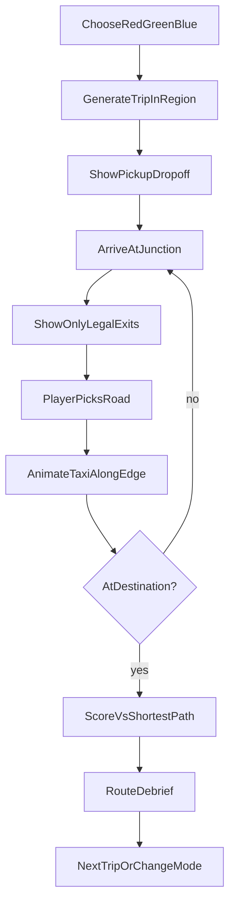

# Hong Kong Taxi Map — Game Design Plan

## Pitch

A turn-based taxi navigator set on a real-ish Hong Kong road map. Each trip generates pickup → dropoff. At every junction the player picks **one legal next road**. The game measures how close they stay to the **shortest legal path** — the game’s stand-in for HK’s “shortest, most direct” expectation.

**Locked design choices**

- Control: **junction choices** (not free steering)
- Rule fidelity: **training-lite** — road graph + legal constraints; score vs shortest distance; not Transport Department case adjudication
- Presentation: **map + taxi avatar** (avatar colour matches mode)
- Score core: **player distance vs optimal shortest distance**
- Economy layer: **live meter fare** using that mode’s Red/Green/Blue tariff
- Modes: **Red / Green / Blue** taxi types, each locked to its service region
- Platform: **responsive web** — playable in browser on phone and computer (not native/Expo for v1)

---

## Game modes (taxi type × service region)

Player picks a mode before a session. Mode sets map bounds, landmark pool, trip generator, avatar colour, and which graph edges are usable.

| Mode | Taxi | Service region (game) | Feel |
|---|---|---|---|
| **Red** | Urban | Hong Kong Island + Kowloon (urban core; harbour crossings) | Dense junctions, tunnel/bridge choices |
| **Green** | New Territories | NT operating area (e.g. Tuen Mun, Yuen Long, Sha Tin, Tai Po, Tseung Kwan O corridors as content allows) | Longer arterial runs, town-centre webs |
| **Blue** | Lantau | Lantau Island operating area | Sparser network, airport/Disneyland-style landmarks |

**Mode rules (training-lite)**

- Trips **only** generate pickup and dropoff inside that mode’s region.
- Routing uses only edges tagged as allowed for that taxi type (restricted / out-of-area roads never appear as choices).
- Shortest-path optimal is computed on that **same filtered subgraph** — fair comparison.
- Cross-region specials (e.g. Red to airport under real-world exceptions) are **out of v1**; keep modes clean and teachable.
- Mode select shows a short region blurb + map silhouette so players know what they are testing.

**Content phasing**

- **Red** — first fully playable mode (highest junction density, strongest “HK taxi” fantasy).
- **Green / Blue** — same UX and scoring; unlock when their region graphs + landmarks ship. Mode buttons can show “Coming soon” until ready, or soft-lock behind a Red competence badge.

---

## Core loop

1. **Mode select** — Red / Green / Blue; taxi colour and region preview.
2. **Brief** — origin, destination, district labels (e.g. Red: “Mong Kok → Causeway Bay”).
3. **Drive** — coloured taxi on current node; camera follows; only legal outgoing edges for this mode.
4. **Commit** — pick a road; avatar animates; distance accumulates.
5. **Meter** — fare ticks up live from distance (and waiting if the player idles / animation includes wait).
6. **Arrive** — compare to shortest legal path on the mode subgraph; also show optimal path’s meter total.
7. **Debrief** — dual route overlay; excess km, fare vs optimal fare, grade; option to stay in mode or return to mode select.

---

## Meter fare

Fare is a **first-class HUD**, not a later flavour bolt-on. It uses simplified official-style tariffs per taxi type (flag fall + incremental distance; waiting time when the clock runs).

**Per mode**

- Each of Red / Green / Blue has its own tariff table (flag $, first N km, then $ per step of distance, waiting $ per period).
- `calculateFare(mode, path, waitingSeconds)` runs on the player’s driven edges.
- Same function on the optimal path → “what the meter should have been” on debrief.
- Tunnel/bridge **tolls** (if the path uses those edges): add as line items when the edge is flagged `toll_hkd` (training-lite; optional toggle “include tolls”).

**During trip**

- Meter widget: running fare in HKD, distance so far, mode colour accent
- Updates as each edge completes (and ticks during wait if waiting is enabled)

**Debrief**

- Player fare vs optimal fare (+ difference)
- Breakdown: flag + distance charge + waiting + tolls
- Primary grade still from **excess distance**; fare difference is the passenger-facing consequence (“you cost them $X extra”)

**Honesty:** tariff numbers are game approximations of published schedules; show “Game meter — not a legal fare quote” in small print.

---

## What “training-lite” means here

| Included | Excluded |
|---|---|
| One-way streets | Using fare alone as the primary skill grade |
| Prohibited turns / no-entry | Full TD complaint / “reasonable route” case law |
| Restricted / taxi-inaccessible links | Time-of-day peak bans in v1 (optional later) |
| Tunnel / bridge as normal edges with length | Claiming “this is legally definitive” |
| Shortest path = Dijkstra (or A*) on legal graph | Multi-objective “fastest vs shortest” as the main rule |
| Per-mode meter fare (flag + distance + waiting) | Every real surcharge edge case on day one |

Players **cannot choose illegal moves** — legality is enforced in the choice UI, not punished after the fact. The skill test is **geographic judgment among legal options**, not memorizing the ordinance text.

---

## Map & data model

Treat the city as a **directed weighted graph**:

- **Node** — junction / decision point (lat/lng, name optional, `regions[]`)
- **Edge** — legal travel from A→B: `length_m`, road name(s), flags (`tunnel`, `bridge`, `restricted`), `taxiTypes[]` (`red` / `green` / `blue`)
- **Turn table** — at node N, for arrival edge `in`, which outgoing edges are allowed (encodes prohibited turns); evaluated after taxi-type filter
- **Landmarks** — pickup/dropoff anchors snapped to nearest node, tagged with `taxiTypes[]` / region
- **Service region polygons** — used for mode map framing and authoring validation (landmark must lie in mode region)

**Geography by mode**

- **Red (v1 playable):** Island north shore + Kowloon urban core (harbour crossings).
- **Green:** NT town centres and connecting arterials as coverage grows.
- **Blue:** Lantau road network around Tung Chung / airport / Discovery Bay corridors as coverage grows.

**Authoring pipeline (design intent):**

1. Import OSM (or similar) road centerlines for the v1 bbox.
2. Simplify to decision nodes (collapse pure through-links).
3. Bake one-ways and basic turn restrictions from OSM `restriction` relations where available.
4. Hand-curate high-traffic “trap” corridors (unnecessary harbour loops, obvious detours) for trip difficulty.
5. Validate: every landmark pair used in trips has a finite shortest path.

Optimal path = **shortest distance** on this directed graph respecting turn restrictions (state can be `(node, arrival_edge)` if turns depend on how you entered).

---

## Player-facing UI

**Responsive layout**

- **Phone:** map fills upper viewport; choice buttons as a bottom sheet (thumb reach); large tap targets; no hover-only controls
- **Desktop:** map dominant; choice panel as side or bottom bar; click + keyboard (1–4 for exits) optional
- One codebase, CSS breakpoints; portrait-first on mobile, comfortable widescreen on desktop
- Touch pan/zoom on map; pinch-zoom allowed but not required to play (choices stay readable without zooming)

**Mode select**

- Three large mode cards: Red Urban / Green NT / Blue Lantau (stack on phone, row on desktop)
- Each card: coloured taxi icon, region name (EN + 中文), one-line service blurb, playable or locked state
- Choosing a mode sets session taxi colour and loads that region’s map framing

**During a trip**

- Full-bleed (or large) map; taxi avatar tinted to mode colour
- Destination pin always visible; optional faint “you are here” district label
- Choice panel: 2–4 legal exits as large buttons (road name + direction glyph)
- HUD: mode badge, **live meter (HKD)**, distance so far, remaining “as crow flies” optional, trip timer optional (soft pressure, not primary score)

**Choice design rules**

- Never show illegal turns
- Prefer **named roads** over raw bearings when names exist
- If >4 legal exits, rank by “how different the corridors are” and show top 4 + “More…” only if needed (rare after graph simplify)

**End of trip**

- Dual route overlay
- Stats: player km vs optimal km, excess %, **player fare vs optimal fare**, junctions taken
- Fare breakdown (flag / distance / waiting / tolls)
- Grade band (example): Perfect ≤0%, Good ≤5%, Fair ≤15%, Detour >15% (from distance excess)
- One teaching line: “Optimal stayed on Nathan Rd; you looped via Prince Edward — meter +$X.”
- Debrief actions thumb-friendly on phone (Next trip / Change mode)

---

## Trip generation

**Goals:** variety, fair difficulty, teach real corridors.

- Sample origin/destination from the **active mode’s** landmark set with min graph distance (e.g. ≥1.5 km) so there are real choices
- Difficulty tags:
  - **Easy** — few junctions, one dominant corridor
  - **Medium** — 2–3 plausible corridors; one clearly shorter
  - **Hard** — Red: harbour / multi-tunnel temptation; Green: town-to-town arterial choice; Blue: sparse wrong-spur traps
- Avoid trivial A→B with only one legal chain
- Session formats (within a taxi mode): **Career** (seeded trip list), **Practice** (pick districts inside region), **Daily Challenge** (one shared seed per taxi mode)

---

## Scoring & progression

**Primary score (per trip):** excess distance ratio  
`excess = (player_m - optimal_m) / optimal_m`

**Meter (always shown):** player fare and optimal fare from `calculateFare`; extra fare is the readable consequence of detours.

**Secondary (optional):** time taken / waiting accrued, wrong-corridor early detection (soft hint unused), streak of Perfect/Good.

**Progression hooks (light):** per-mode star ratings and “local” badges (Urban / NT / Lantau) when average excess is under threshold. Optionally unlock Green/Blue after a Red badge. Keep fantasy as **nav competence**; meter makes cost of bad routes visceral without turning the game into a tycoon.

**Honesty label in UI:** “Scored against the shortest legal path on this game map — not a legal ruling. Meter is a game approximation.”

---

## Difficulty & fairness

- Same trip → same optimal path (deterministic graph)
- Randomization only in trip selection / landmark pair, not in edge lengths mid-run
- If player backtracks, count full distance (teaches commitment)
- Soft undo: none in scored mode; one peek at destination name is free

---

## Content that makes it “feel HK”

- Landmark language: bilingual labels (EN + 中文) for roads and places
- Iconic traps: unnecessary Cross-Harbour Tunnel when a shorter land path exists within district; wrong tunnel choice between Island and Kowloon; Nathan Rd vs side-street weave
- Urban texture: Red / Green / Blue taxi avatars matching real HK fleets; familiar map styling (not generic purple UI)
- Mode identity: region silhouette and bilingual mode names on select screen

---

## Technical shape (when you build later)

Not implementing in this step — design targets only:

- **Platform:** responsive web app (browser on phone and computer); PWA install optional later, not required for v1
- **Client:** MapLibre GL JS (or similar) + avatar along polyline; mobile-friendly touch map
- **Sim core:** graph filtered by `taxiType`, turn-legal successors, Dijkstra/A*, `calculateFare(mode, path)`, `generateTrip(mode)` — pure logic, unit-testable without UI
- **Tariffs:** versioned JSON per Red/Green/Blue (easy to update when published fares change)
- **Content:** GeoJSON/JSON graph + landmarks tagged by taxi type/region; versioned so Daily Challenge stays stable per mode
- **Deploy:** static/hosted web (e.g. Vercel/Netlify/Cloudflare Pages) — open a URL and play

---

## V1 scope vs later

**V1 ship**

- Responsive web game (phone + desktop browsers)
- Mode select: Red / Green / Blue (Red playable; Green/Blue present, lock or ship as content is ready)
- Junction choice + legal-only exits on the active mode subgraph
- Map + colour-matched taxi avatar animation
- Live meter fare (per-mode tariff) + optimal fare on debrief
- Shortest-distance optimal scoring + debrief overlay
- Red landmark trip generator (Island north + Kowloon)
- One-ways + prohibited turns + restricted / out-of-region edges filtered out

**Later**

- Full Green NT and Blue Lantau graphs
- PWA / home-screen install
- Time-of-day restrictions
- Richer surcharges (luggage, extra passengers, animal, booking) as optional toggles
- Passenger voice / destination clarification mini-events
- Optional cross-boundary special trips (explicitly marked, not mixed into normal Career)
- Multiplayer ghost routes / leaderboards on Daily Challenge per mode

---

## Success criteria

Playable in a browser on phone and computer without a native install. Mode select clearly teaches Red/Green/Blue service regions. Meter runs during the trip and debrief shows fare vs optimal. A player who knows that region grades Good/Perfect; a tourist guessing by compass alone grades Detour and pays more on the meter. Out-of-region and illegal moves never appear. Debrief always teaches one concrete corridor lesson for that mode.
